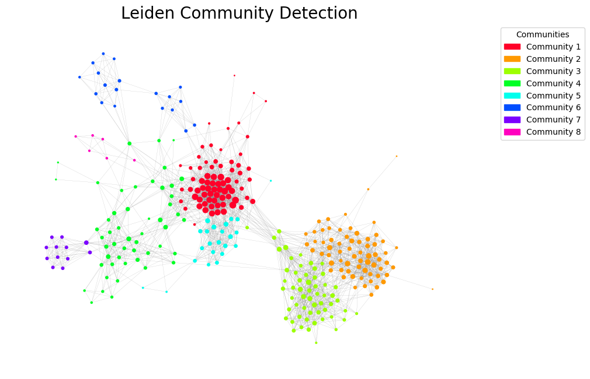
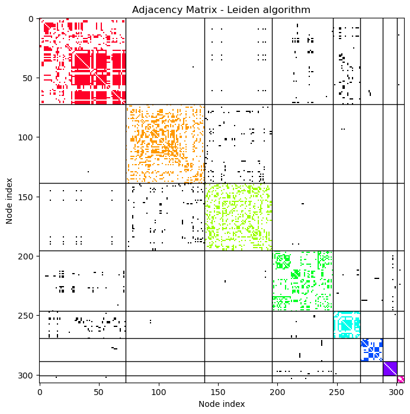
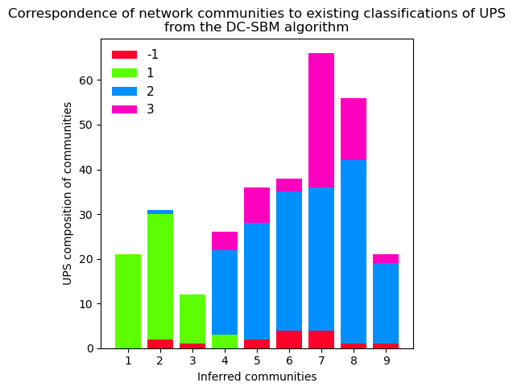

# Community Structure of a Malaria Gene Network

Comparison of five community detection algorithms (Greedy, Louvain, Leiden, Infomap and the degree-corrected stochastic block model) on the network of var genes from the malaria parasite Plasmodium falciparum, interpreted against known biological classifications.

Group project for the Complex Networks course of the MSc in Health Data Science (MHEDAS), Universitat Rovira i Virgili.

## Overview

The var genes of Plasmodium falciparum encode PfEMP1, a protein that lets the parasite evade the immune system and drives disease severity. This project studies HVR_1, a network in which each node is a var gene sequence and each edge links two sequences that share a significant exact match in their highly variable region.

The network has 307 nodes and 2812 edges. It is connected, with an average degree of 18.3, a high average clustering coefficient (0.57), positive degree assortativity (0.60), an average path length of 3.5 and a diameter of 8. The degree distribution is bell-shaped rather than scale-free, and of the standard generative models the network is closest to a small-world Watts-Strogatz network.

The central question is whether communities found from the network structure alone match what is known about these genes: a six-group classification by cysteine count and motifs (Cys/PoLV) and a four-group classification by promoter type (UPS).

## Results

| Algorithm | Communities | Modularity | Community sizes |
|-----------|-------------|------------|-----------------|
| Greedy | 5 | 0.5929 | |
| Louvain | 8 | 0.6399 | |
| Leiden | 8 | 0.6401 | 73, 66, 57, 51, 23, 19, 12, 6 |
| Infomap | 2 | | 185, 122 |
| DC-SBM | 9 | | 66, 56, 38, 36, 31, 26, 21, 21, 12 |

The reference partitions have 6 groups (Cys/PoLV) and 4 groups (UPS). Modularity was computed only for the modularity-based methods.

Key findings:

- The network is strongly modular: the three modularity-based methods reach a modularity of about 0.6, and Leiden gives the highest value and a balanced partition, so it was chosen as the representative of that family.
- Leiden splits the reference groups into sub-modules rather than reproducing them. Its communities are mixed in Cys/PoLV and UPS composition, although one of them is made up entirely of UPS A genes, a promoter type linked to severe malaria.
- Infomap finds only two large communities, so it reveals broad structure and not the finer sequence-based groups.
- The degree-corrected SBM best separates the virulence-associated genes: three of its communities are dominated by UPS A and Cys/PoLV 1 to 3, and the other six by Cys/PoLV 4 and UPS B and C.







## Data

The data is the HVR_1 network from the `malaria_genes` collection on [Netzschleuder](https://networks.skewed.de/net/malaria_genes), originally published by Larremore et al. (2013). The three files (`edges.csv`, `nodes.csv` and `gprops.csv`) are in [`data/`](data/README.md), together with a description of the variables and the two reference classifications.

## Methods

1. **Network characterisation:** degree distribution (including a log-log fit that rules out a power law), clustering, assortativity, path lengths and centralities (degree, betweenness, closeness and eigenvector).
2. **Generative model comparison:** the network was compared with the Erdos-Renyi, Watts-Strogatz, Barabasi-Albert and configuration models.
3. **Modularity-based detection:** greedy modularity maximisation, Louvain (best of 101 seeds) and Leiden (best of 100 seeds), compared on modularity and number of communities.
4. **Infomap:** a random-walk method that minimises the description length of the walker's path, with the seed chosen from 100 runs.
5. **Degree-corrected SBM:** a statistical model that accounts for differences in node degree, fitted with `graph-tool`.
6. **Interpretation:** adjacency matrices ordered by community, the composition of each community by Cys/PoLV and UPS class, and per-community size, density, hubs and betweenness.

The full methodology, results and discussion are in [`docs/community_structure_report.pdf`](docs/community_structure_report.pdf).

## Repository structure

```
.
├── data/
│   ├── edges.csv
│   ├── gprops.csv
│   ├── nodes.csv
│   └── README.md
├── docs/
│   └── community_structure_report.pdf
├── figures/             
├── notebooks/
│   └── community_detection.ipynb
├── README.md
└── requirements.txt
```

## How to run

The `graph-tool` library is only available on Linux and macOS (on Windows, use WSL) and is installed through conda.

```bash
git clone https://github.com/cindychenqiu/malaria-network-community-detection.git
cd malaria-network-community-detection
conda env create -f environment.yml
conda activate community-detection
jupyter notebook notebooks/community_detection.ipynb
```

Tested with Python 3.12.

## Limitations and next steps

- **Seeds were chosen by hand for Infomap and DC-SBM:** the Infomap seed was the first one whose partition resembled the reference classifications, and the DC-SBM seed was the one with the fewest communities (9, while across 2000 seeds the count ranged from 9 to 91). This tunes the results towards the references.
- **No quantitative comparison with the references:** the match with Cys/PoLV and UPS is judged visually and from composition plots. A measure such as normalised mutual information or the adjusted Rand index would make it objective.
- **No common quality score:** modularity is reported only for the modularity-based methods, so Infomap and DC-SBM are compared qualitatively.
- **Different resolutions:** the algorithms return between 2 and 9 communities, against 6 and 4 reference groups, which makes direct comparison difficult.
- **One network:** this is only HVR_1, one of the nine variable regions available in the original data.

## Authors and acknowledgements

Group project by Keith Megara Osores Vicuña and Cindy Chen.  

[LinkedIn](https://www.linkedin.com/in/cindychenqiu/) | [GitHub](https://github.com/cindychenqiu)